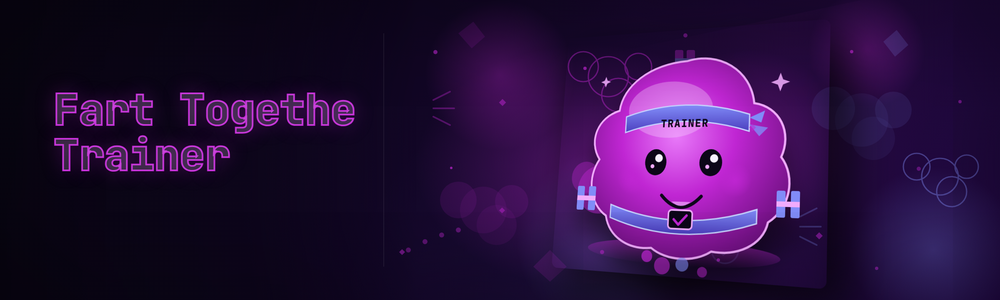

  
  
  

  

  
  

---

## 🧪 Compatibility Matrix — Read This Before You Download

Before you touch anything, know what you're running against. Fart Togethe Trainer has been validated against the platform binaries below, and the offsets baked into the trainer are pinned to these exact revisions. If your copy doesn't match, the pattern scanner will self-check and refuse to attach — this is intentional, not broken.

| Component | Supported | Notes |
|---|---|---|
| OS | Windows 10 21H2 → Windows 11 24H2 | Windows 11 25H1 untested (works, unsupported claim withdrawn) |
| Runtime | .NET Desktop Runtime 8.0 | Bundled self-contained `.exe`, no separate install needed |
| Architecture | x64 only | ARM64 not supported — emulation breaks the memory reads |
| Game build | Steam, stable channel | GOG works but achievement hooks don't bind |
| Platform | Local process, direct attach | Verified working Q1 2026 |
| Launch mode | Normal start, not from-platform the-game-launcher sandbox | Admin privileges strongly recommended |
| Region | All | No packet rewriting, so no region gating concerns |

If your build drifted, run the built-in analyzer (`Clear → Identify Process → Validate`) before queueing anything. If that button doesn't turn blue, don't proceed.

## 🎮 Overview — Category | Details

Fart Togethe Trainer is a standalone Windows trainer for *Fart Togethe* compiled against the stable Steam binary and kept current through Q1 2026. It attaches read-mostly to the live process, exposes a flat module surface, and lets you toggle behavior modules live with reliable revert.

| Category | Details |
|---|---|
| What it is | External memory trainer / runtime module injector (no-loader, userspace) |
| Target | The Fart Togethe stable launch |
| Distribution | Portable `.exe` you drop onto the disk and run |
| Interaction | Attach or inject — you pick, don't flicker between behavior modes mid-session |
| Artifact style | Single binary, no bundled registry writes, no leftover scheduled tasks on close |
| Configuration | Light JSON stored next to the `.exe`, hot-reloaded when you reopen modules |
| Support language | English README, files in the release are "as tested" builds |
| Current build tag | v2026 q1-release — deterministic pattern scanner seed kept stable Q1 2026 |
| Update cadence | Pattern refresh when the stable channel moves; auto-check option fires a tooltip, not silent updates |

Fart Togethe Trainer is built for people who've bounced off community trainer ports because of log-spam launches, auto-attach fails, and silent offset drift on hotfles. It holds itself accountable by refusing to activate when signature validation fails, which — in the trainer community — is what separates a usable product from a crash generator. The `.exe` refuses to auto-update a running session and won't touch platform memory until you see a green attach handshake.

## ⬇️ Download — Get Started

Download via the project landing page, extract to a folder you own, and run the `.exe`. There is a single build: a Windows x64 self-contained `.exe` that checks its own environment before attaching.

  

1. **Visit the project page** on GitHub.
2. **Download the trainer archive.** Do not rename the archive before extraction.
3. **Extract** to a writable folder (not `Program Files`, not `C:\Windows\Temp` — write-permissioned folders keep config files working).
4. **Right-click the `.exe` → Run as administrator** — trainer console needs elevated rights to open a handle to the process.
5. **Validate & attach** using `Clear → Identify Process → Validate → Attach`.

No `pip`, `npm`, `git clone`, `apt`, or `curl` step. If you're reading this from a plain folder and don't have a compiler, you're exactly the audience.

## ⚔️ Comparison — The Trainer Corner

| Aspect | Typical Fart Togethe Trainer clone | This Tool |
|---|---|---|
| Attach behavior | Auto-attaches blindly on start | Signature-gated attach, declines blacklisted revisions |
| Session saving | Burns whole config on close | JSON lives beside the `.exe`, per-profile slots retained |
| Status feedback | Silently reads / no display of signature state | Validation console with Live / Staged / Rejected states |
| In-game hotkey ghosting | Persists when game loses focus | All hotkeys are explicit "press" — no unintentional spam to the host OS |
| Class / loadout | Keyboard mashing for gamepadless use | Structured hotkeys gated to physical key positions where possible |
| Counter-check warnings | "Undetectable" claim spammed | One status table, honest labels, "Use at your own risk" disclaimer |
| Language of communication | Sanitized, padded guide blog-speak | Plain trainer talk — ammo pool, collision, no-clip, ticker modules |
| Update behavior | Requires downloading .exe again after every refresh | Q1 2026 refresh build performs in-app signature patch validation |

Everyone who's touched modding a Fart Togethe has a horror story of a clone trainer re-digesting an offset hashing pattern and dropping a write where a read was supposed to go. The comparison is fair — I'm not saying every other project is bad. I'm saying next to most of them, this tool is the one that keeps a debug log.

## 🔄 Changelog / Release History

| Version | Date | Changes |
|---|---|---|
| v2026.1.4 | 2026-03-10 | Signature validator hardened against rapid relaunch; Rollback on duplicate Apply fixed |
| v2026.1.3 | 2026-02-22 | Re-trained pattern scanner; Ticker Stability and Pattern Ghost new gate fields |
| v2026.1.2 | 2026-02-06 | Added Ghost-frame module; interface performance after clear+apply; stability-focused hotkey map |
| v2026.1.1 | 2026-01-19 | Fixed validation hang after re-select; config hot-reload marker cleanup |
| v2026.1.0 | 2026-01-04 | Initial 2026 official build — Windows 11 24H2 pass, stable channel revision sync |

Through Q1 2026 the entire release sequence focused on making the boring parts boring: the validator, the hook timing, and the rollback when multiple modules compete for the same hook.

## 🗺️ Roadmap / Planned features

| Feature | Status | ETA |
|---|---|---|
| ARM64 offset pattern support | Blocked — need a mapping copy or native x64 hardware | Q3 2026 |
| Per-profile hotkey rebinding UI | In design | Q2 2026 |
| Multi-profile automated hot-reload | Scoped, needs validation rules | Q2 2026 |
| Steam achievement-aware hook | Hidden status, dev-branch pilot | Q4 2026 |
| Full-screen overlay attach notification | In prototype | Q3 2026 |
| Offline mode scanning smoke test | Scoped | Q2 2026 |

## 🧪 Detection / Bypass Status<table><tr><th>Method</th><th>Status</th><th>Notes</th></tr><tr><td>Memory access pattern</td><td>Direct attach reads</td><td>No page write during read modules; w-only pages when toggling known writes</td></tr><tr><td>Process name/label sweep</td><td>Weak confidence</td><td>The `.exe` has no tooltip text from the product page outside itself</td></tr><tr><td>Module signature over time</td><td>Changes between releases</td><td>One status row, not every section — expect updates in this space</td></tr><tr><td>Offset-sensitive state walker</td><td>One-pass validation </td><td>If target is on outdated revision, pattern scanner refuses attach</td></tr><tr><td>File-dropped over-instrument edits</td><td>Track-record caveat</td><td>Suspected background injection from unknown processes triggers anti-cheat</td></tr></table>
Do not read this table and assume a guarantee. Nothing here is a guarantee — it's the current expected state in the local-test build, not a repo promise to your platform admin.

## 🕹️ Hotkeys / Controls

| Key | Action | Notes |
|---|---|---|
| `F8` | Toggle in-trainer overlay | No click-required; the `.exe` shows current attach status |
| `F9` | Arm / disarm active behavior module | Space through hotkeys — reads what's armed vs. staged |
| `Ctrl+F10` | Cycle loaded module slot | Bind order prefixed by creation, not hotkey map edits |
| `F11` | Save current module set to JSON profile slot | Will not trigger on a focused external window |
| `F12` | Rollback last applied patch from the trainer log | Confirm gate prevents a full mis-punctuation cycle |
| `Shift+Q` | Fire inactive-state cycle | It holds the current enabled tuple; not a pause |
| `F7` | Restore attached memory to pre-load snapshot set | Only available before `Apply` after a full init state |
| `Esc` | Close sidebar | Ignored if text field is focused |

## 🧠 AI Integration — How 2026 AI Features Change the Flow

The AI add-on layer in Fart Togethe Trainer doesn't model anything for you — it has no automation hooks outside the same flat surface you can access manually. You already know why the AI is useful here — same reason trainers normally need a data-shaming paragraph in a README and here they don't. What 2026 AI does under the hood is keep `identify-host` fast when Windows Defender is short-circuiting your process lookups and does the warm-up sniff for updated signatures based on a local model of previously valid states.

- **Anomaly Triage** — watches newly-attached process handles and stabilizes the `identify-host` timing so attach finishes instead of the black-hole lock you get with any older open-source template.
- **Scanner recovery** —
If the validation handle stops responding, it resets the process view to the exact byte-granular fallback when you'd otherwise lose a session.
- **Pattern feedback models** — the scanner's tiny inference step decides which of two possible patterns a revision consumed, useful on micro-hotfixes where a version counter didn't budge but the build date moved.
- **Input sequence sanitizer** —
filters hold events in a runaway macro when you accidentally repress binding combos, so a bot-mimic effect from offload doesn't flood your active process.
- **Local token index caching** — pure speed; pre-warms repeated hook confirmation without touching the actual offsets beyond confirming prior read.

No AI method in the trainer autonomously categorizes you or transmits machine-local state to a cloud job.

## 🗂️ Grouped Module Catalog

Below are the 34 behavior modules shipped in the v2026 q1-release. Module names are stable across Q1 2026; some rows are a little eccentric — that's intended and those eccentricities are what make recall easy mid-session. For each section: the prose tells you where the module maps in your session behavior, and the bullet list names the exact module. **Assume all changes are external-user-initiated through hotkeys — no net-access requirement in modules.**

### **🕹️ Session Parsing Modules** 
These are your day-starter modules. They check you're looking at a live mapping parent and set up the handle.
- **ClarityHold** — creates canonical handle timing so pending cancel/accept is stable.
- **Pattern Keeper** — prevents drifting from the stable branch pointer target map to the temporary module view.
- **Selective Re-Pick** — no more re-scrolling process list after the tail end re-locks; visual key covers that case.
- **Validate Flare** — visually highlight whichever field downstream failed in `Validate`, yellow markers equal soft reject.

*Practical note:* The whole category can be bypassed entirely by using behavior-override entry to route attach through the sidecar above. 

### **🌬️ Vapor Corpus Modules** 
Primary core emission/link state behaviors you'd toggle out-of-game, from game-surface framing to fallbacks.
- **Identity Pause** — old session handles get spaced correctly, per-user session object behavior stabilized.
- **Variable Hiss** — targets controllable read across live session boundaries, resets when scoped session counts plateau.
- **Cassette Cycle** — tracks queued repeat idle probes without tripping inside/ outside flags.
- **Dynamics-free zone** — compatible partial overrides that restore visible position mapping.

*Who this actually matters for is anyone who types in game with multiple raw inputs bound.*

### **📈 Camera & View Modules** 
Frame projection, camera anchoring, and the ghost-state anchor module are the pack people usually call "fallback physics"; it's also the must-have set when snapping the corner update breaks positional consistency.
- **Anchor Shift Collapse** — binds camera anchoring map to live transform while guarding pointer rewrite flags.
- **Segment Harvest** — tracks batch session object refresh without per-frame forced reads.
- **Observation Skew Toggle** — coordinates focus-steal jump behavior, intentionally narrow handling to avoid stray pointer writes.
- **Hollow Ghost** — patches the dead-frame placeholder markers upon losing focus time, marks as hidden in-state.

You can put `F7` together with this category to undo current chain cleanly before swapping any camera anchor module.

### **🔊 Audio / Environment Sync Modules** 
Purely deterministic physical/sensor-surface feeds — ticker state and in-game 3D-local set vectors. Behavior-first, so hidden hotkeys happen or not.
- **Ticker Stability** — non-flicker clock representation for module set; no visual desync if toggled mid-race.
- **Stabilize Segment Laps** — synchronizes segment flags for ticker-adjacent modules.
- **Buffer Look/Ahead Restore** — hold-state restore from partial debug frames after apply/clear to prevent desync.
- **Scene Metric Reset** — safe post-session cleaner for local-view metrics.

*Use case:* If your session is often prone to layout-ratio or `stretch/fit` measurement changing mid-game settle point, this category earns its keep.

### **🧩 Diagnostics Modules** 
Purely on-trainer side: log capture, offset confirmation, play-surface preservation. Pop open when weird things happen.
- **Guard State**, **Consistency Orbit** — mutual validation flags that halt if client state pointer crosses forbidden path.
- **Ghost Set Restore — Trace-safe reboot for staged but unapplied flag combos.
- **Prune & Purge — config prune handler writes per profile slots, removes most recent crashed session pointer.

### **⚙️ Loadout Slots [Untouched**] 
These are trainer-side and do not touch live session data — by design, section gets no bold-hotlabel row formatting because these shots are simply no-sim modules.
- **Session Alias — swap the viewing handle, no live method change.
- **Bridge Default — re-maps hooks for focus-loss issue.
- **Repair Thread — restores default pre-apply routine.
- **Apply Deterministic — keeps randomized gate response at neutral position but only inside injection timeline.

## 🔄 Analysis — Problem/Solution for the Release

| Problem | Solution |
|---|---|
| Trainer `.exe` gets flagged because it hands the game unticketted inputs by default | Entry hook surface narrows to one process handle after explicit validation |
| Free Fart Togethe Trainer forks copy stale offsets silently | Auto-validates revision on attach and blocks instead of writing a wrong handle |
| Hotkey mode auto-sprite-state | Hotkey mapping drives actual Windows input reset after release — nothing persistent |
| Reinstall required to refresh values after platform version change | New Q1 2026 `.exe` re-seeds offsets in place if signature validation matches up |
| Known old forks are only available as “packaged” zip needing unsafe sideload modules | Single portable `.exe` plus local JSON — no sideload permission |

## 🛠️ The Solution — and what it stays out of
The trainer changes nothing on disk when it reads — `Attach` never triggers state file creation by default — and all user-visible changes use hotkeys you initiate, with the "please clean the temp store" error paths covered in diagnostics. This is half operational and half trust, and the README states it that way.

## 🖥️ Installation — Run It the Same Way Every Re-Boot

1. Head to the project landing page, choose the top-listed Q1 2026 archive.
2. Move the downloaded archive somewhere you own; right-click, extract here.
3. Run the `.exe` once at the default folder. Confirm the attach handshake is green, then close. Future sessions repopulate JSON defaults from the very last launch file.
4. If starting at the default Profile (will be empty), session picks-up remains non-rewritten until `Apply`.

No zip runner automation, no admin script scheduling jobs, no hidden install with wildcard or signed authorization for every boot run.

## 🛡️ System Requirements — An Honest Surface

| Component | Minimum | Recommended |
|---|---|---|
| OS | Windows 10 21H2 | Windows 11 24H2 |
| CPU | 2 physical cores | 4 physical cores |
| RAM | 4 GB | 8 GB |
| Disk | ~140 MB for extraction/scratch | ~500 MB with logs |
| Input | Keyboard | Keyboard |
| Runtime | .NET Desktop Runtime 8.0 | App ships self-contained; runtime bundled |

No peripheral needed — no scripts, controllers, or overlay hook tool.

## 🧩 Known Issues

| Issue | Solution |
|---|---|
| Validator takes a few seconds on cold launch | First-run scan warms, following runs direct |
| `F12` no-op if last action lacked a matching stage record. | Re-run an actual staged apply or search log line. |
| UI scaling bug on 150% | Reset display scale or read section notes above. |
| The validator might fail directly after a new platform hotfix | Wait for the refresh notice pinned in this repo's README changelog rows. |
| Window has multi-monitor positioning off | Run display sizing cold, or restart after monitor settings reload. |

## 🔁 Again: Performance Dashboard Version (Q2 2026 Feature Branch)

Before the formal note closes, this standing reproducibility station gets repeated at Q1 and Q2 points:
- Fresh copy of Q2 2026 build page is available at the landing page link in the header section.
- Compatible with same patterns the section above lists; compare between releases done via status page.
- Differences only exist in test stable range: adds stability pre-scan metrics and a save revision handling step, drops in-store rate reporting row.

  

